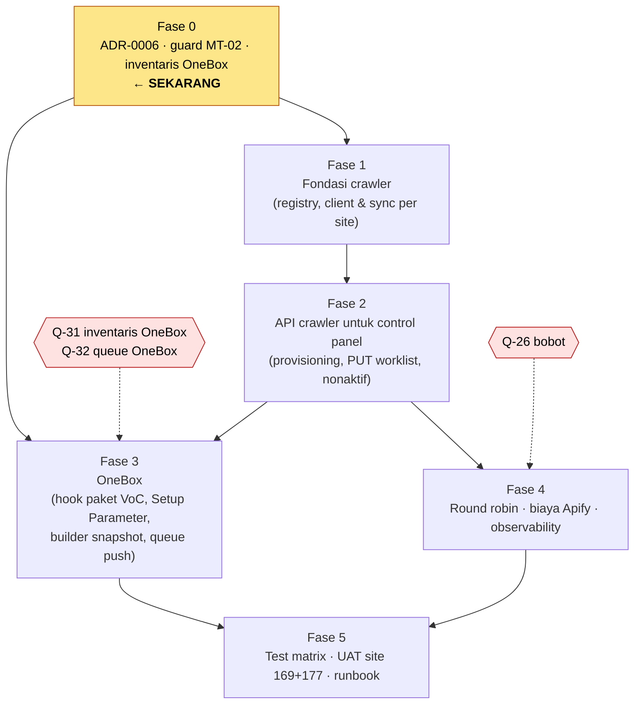

# Multi-Tenant Readiness — Plan

> [!abstract] Navigasi
> [[README|Index]] · [[01-PLAN|Plan]] · [[02-DESIGN|Design]] · [[03-IMPLEMENTATION|Implementation]] · [[04-OPEN-QUESTIONS|Open Questions]]

---

## 1. Tujuan

Satu deployment crawler melayani **banyak tenant OneBox** (satu site = satu company) sekaligus, dengan:

1. **OneBox sebagai control panel.** Tenant baru cukup **mengaktifkan paket VoC** di OneBox; Connection, token, dan worklist terbentuk otomatis.
2. **Nol setup manual di crawler.** Tanpa CLI, tanpa ubah env per tenant.
3. **Satu arah: OneBox → crawler (opsi D).** OneBox mengirim worklist ke crawler; crawler tidak memegang kredensial OneBox dan tidak pernah memanggil OneBox.
4. **Isolasi data mutlak** antar tenant.
5. **Isolasi kegagalan** — tenant bermasalah tidak menghentikan tenant lain.
6. **Adil & terukur** — weighted round robin antar tenant; satu akun Apify platform yang anonim bagi tenant, dengan biaya tercatat per tenant.

**Kenapa:** produk ditujukan ke enterprise yang tersebar luas (contoh: Pertamina, Hermina, Kopi Kenangan), bukan hanya rumah sakit; CEO meminta uji stabilitas saat banyak company crawling bersamaan (`REVISI_CEO_07-08-2026`). Di dev sudah ada **site 169** (utama) dan **site 177** (testing).

## 2. Definisi "siap multi-tenant" (exit criteria)

| # | Kriteria | Bukti |
|---|---|---|
| E1 | Site 177 ter-onboard **hanya** dengan mengaktifkan paket VoC di OneBox | UAT MT-51: nol CLI, nol perubahan env crawler |
| E2 | Token site 177 tidak bisa membaca data site 169 (dan sebaliknya) | T3 + uji manual API |
| E3 | Refresh/crawl site 177 gagal → site 169 tetap jalan | T5 |
| E4 | Paket dimatikan → job pending batal, data utuh; dinyalakan → lanjut tanpa kehilangan data | T6 + UAT |
| E5 | Dua tenant di antrean dilayani sesuai bobot, tanpa starvation | T8 + uji beban kecil |
| E6 | Review site 177 masuk Ticket OneBox di site 177 saja | UAT |
| E7 | Pemakaian Apify bisa dilaporkan per tenant | T11 + laporan |
| E8 | Model tertulis di ADR-0006 (termasuk amandemen ADR-0003 D1) | ADR Accepted (ratifikasi Pak Agung dilacak di Q-23) |
| E9 | Crawler tidak menyimpan kredensial OneBox apa pun; worklist hanya masuk lewat `PUT /worklist` | `grep` env & kode kosong (MT-22) + UAT langkah 7 |
| E10 | Crawler mati sementara → OneBox mengirim ulang otomatis, versi worklist kembali sinkron | UAT MT-51 langkah 3 |

## 3. Scope

**Masuk scope**
- Registry tenant di crawler yang ditulis **hanya** lewat panggilan OneBox (provisioning paket VoC).
- Token per tenant dibuat otomatis dan disimpan di Connection OneBox; tampil di Setup Parameter.
- **Push snapshot worklist** dari OneBox ke crawler (event + scheduled push + cek versi), lewat queue OneBox.
- Penonaktifan / penaktifan ulang tenant.
- Weighted round robin antar tenant di worker crawler.
- Apify lewat satu akun platform (tanpa akun/rotasi/top-up per tenant) + atribusi biaya per tenant.
- Pengurangan setup manual (CLI) di crawler.

**Di luar scope**
- Database atau deployment terpisah per tenant (ditolak).
- Billing/harga — milik OneBox (catatan: harga VoC ± Rp200.000/lokasi).
- Kebijakan pembersihan review di DB crawler — sekarang **disimpan saja**, histori jangka panjang di OneBox (Q-10).
- Kategori ML per tenant — disiapkan wadahnya (`settings`), implementasi menyusul (Q-30).
- Prompt generik di staging — tetap prompt Hermina sampai rilis bertahap (Q-14).

## 4. Keputusan yang sudah diambil (2026-10-21)

| Keputusan | Q |
|---|---|
| Tidak ada service yang loop per site; tenant ada karena paket VoC aktif di OneBox | Q-01 |
| Satu site = satu company; login selalu dengan `siteId` | Q-02, Q-18 |
| Satu crawler untuk semua tenant; token per tenant dibuat crawler saat provisioning | Q-03 |
| **Opsi D:** OneBox push snapshot worklist; crawler tanpa kredensial OneBox (amandemen ADR-0003 D1). Opsi C = cadangan | Q-03, Q-07, Q-16 |
| Semua kredensial dikelola OneBox; nol proses manual | Q-04, Q-05, Q-08 |
| Tenant nonaktif: pending batal, claimed selesai, data tetap | Q-09 |
| Weighted round robin di crawler | Q-12 |
| Uji di dev dengan site 169 + 177 | Q-20, Q-24 |
| Apify: satu akun platform, anonim bagi tenant; biaya tetap dicatat per tenant | Q-11 |

## 5. Gerbang yang masih terbuka

| Gerbang | Pertanyaan | Menghambat | Status |
|---|---|---|---|
| G1 — Istilah & ADR | Q-25 (proxy check), Q-23 | MT-01 | open |
| G2 — Kondisi OneBox nyata | Q-31, Q-35 | Fase 3 | partial — putaran 1 selesai; definisi gerbang "paket VoC" (Q-35) terbuka |
| G3 — Outbox OneBox (syarat opsi D) | Q-32 | MT-30, MT-33, MT-35 | partial — **belum ada outbox**, harus dibangun (tabel DB atau RabbitMQ); fallback opsi C bila terlalu mahal |
| G4 — Bobot round robin | Q-26 | MT-40 | open |
| G5 — Usulan yang perlu dikonfirmasi | Q-28, Q-29, Q-33, Q-36 | MT-13, MT-30–33 | proposed |

## 6. Fase & urutan

| Fase | Isi | Task | Prasyarat | Status |
|---|---|---|---|---|
| **0** | ADR-0006, guard refresh lintas tenant, inventaris kode OneBox | MT-01 – MT-03 | — | MT-02 `done`, MT-03 `wip`, MT-01 `todo` |
| **1** | Migration registry tenant + `snapshot_version`, mode config, `apply_snapshot` | MT-10, MT-11, MT-13 (MT-12 `dropped`) | — | `todo` |
| **2** | Endpoint provisioning, `PUT /worklist`, tenant nonaktif; hapus jalur pull di akhir transisi | MT-20 – MT-23 | Fase 1 | `todo` |
| **3** | Hook paket VoC, Setup Parameter, builder snapshot + counter versi, job push (queue/retry/debounce), scheduled push + cek versi | MT-30 – MT-33, MT-35 (MT-34 `dropped`) | MT-03, Fase 2, G2, G3 | `blocked` (MT-03) |
| **4** | Weighted round robin, atribusi Apify, observability, setting tenant | MT-40 – MT-42, MT-44 (MT-43 `dropped`) | Fase 2, G4 | sebagian `todo` |
| **5** | Test matrix, UAT dev, runbook | MT-50 – MT-52 | Fase 3, Fase 4 (min. MT-40) | `todo` (test bertahap) |

**Prinsip urutan**
1. **Amankan dulu.** MT-02 sebelum site 177 diberi company/token di crawler.
2. **Tanpa big-bang.** Mode `single` (pull + env lama) tetap jalan sampai mode `managed` (push) terbukti di dev & staging; jalur pull dan semua env kredensial OneBox dihapus di akhir (MT-22).
3. **Crawler dulu, OneBox menyusul.** Fase 1–2 bisa dikerjakan dan diuji dengan panggilan HTTP tiruan (Postman/pytest) sementara repo OneBox disiapkan.
4. **Satu task = satu PR**, contract test tetap hijau.

## 7. Pembagian sisi

| Sisi | Task | Catatan |
|---|---|---|
| Crawler (repo ini) | MT-02, MT-10, MT-11, MT-13, MT-20–23, MT-40–42, MT-44, MT-50 | |
| OneBox (`onecloud`, PHP) | MT-03, MT-30–33, MT-35 | Repo OneBox belum ada di laptop cadangan — butuh setup dulu (sedang diinstal) |
| Keputusan / non-kode | MT-01, MT-51, MT-52 | Ratifikasi Pak Agung untuk ADR-0006 (Q-23) |

## 8. Gambaran skala (untuk sizing)

| Angka | Nilai | Sumber |
|---|---|---|
| Lokasi per tenant (maks) | ± 100 | Q-13 |
| Review per lokasi (maks / rata-rata) | ± 1.000 / ± 500 | Q-13 |
| Backfill tenant terbesar | ± 100.000 review | turunan |
| Biaya Apify | $20 ≈ ± 100.000 review (perkiraan); satu akun platform | Q-11 |
| Harga VoC | ± Rp200.000 per lokasi (perkiraan) | Q-11 |
| Jumlah tenant aktif, review baru per hari | **belum diketahui** | Q-13 |

## 9. Risiko program

| Risiko | Dampak | Mitigasi |
|---|---|---|
| Kode OneBox ternyata berbeda dari asumsi dokumen | Rework Fase 3 | MT-03 sebelum Fase 3; Fase 1–2 netral |
| Site 177 diberi token sebelum MT-02 | Data site 169 tersalin ke company site 177 | MT-02 prioritas tertinggi |
| Queue OneBox kurang andal untuk retry/debounce/status | Push & deaktivasi bisa hilang diam-diam (opsi D tidak punya self-healing dari crawler) | Q-32, MT-03; scheduled push + cek versi (MT-35); fallback opsi C |
| Rework jalur pull yang sudah dibangun (client worklist, registry mode) | Kerja terbuang sebagian | `_validate_payload`/`_apply` dipakai ulang; jalur pull tetap sebagai mode transisi |
| Backfill tenant besar memonopoli worker | Tenant lain lambat | MT-40 (bobot + batas konkurensi) |
| Batas/kredit akun Apify bersama tercapai | Semua tenant berhenti bersamaan (satu akun) | Alert + batas konkurensi ≤ batas akun (Q-34, Q-22); atribusi MT-41 |
| Ratifikasi tertunda | Keputusan bisa berubah | Q-23 |

## 10. Log status fase

| Tanggal | Fase | Catatan |
|---|---|---|
| 2026-10-21 | 0 | Plan dibuat dari spec Opsi C + audit kode crawler. |
| 2026-10-21 | 0 | Plan ditulis ulang setelah jawaban Sayyid: model provisioning paket VoC, weighted round robin, nol setup manual. 13 pertanyaan terjawab. |
| 2026-10-21 | 0 | MT-02 selesai: company asing tidak bisa lagi memicu refresh yang menyalin worklist site lain. Site 177 aman diberi company & token di crawler. |
| 2026-10-21 | 0 | MT-03 putaran 1: builder worklist OneBox sudah ada, outbox belum ada, benefit VoC ada enam (Q-35), token per Connection (Q-36). |
| 2026-10-21 | 0 | Perubahan desain Apify: satu akun platform, anonim bagi tenant, tanpa rotasi/top-up per tenant (Q-11 terjawab; Q-34 batas akun bersama ditambah). |
| 2026-10-21 | 0 | Keputusan **opsi D** (OneBox push worklist, crawler tanpa kredensial OneBox). Gerbang G3 diganti keandalan queue OneBox. |
