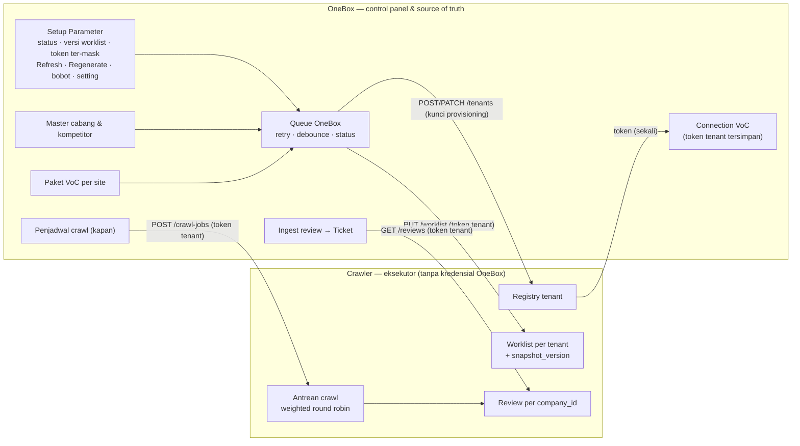
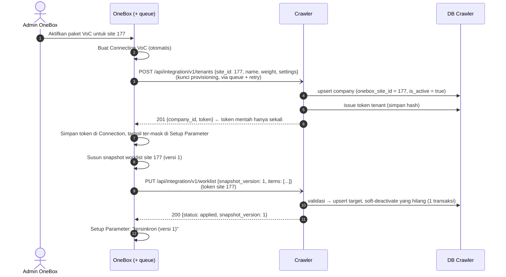
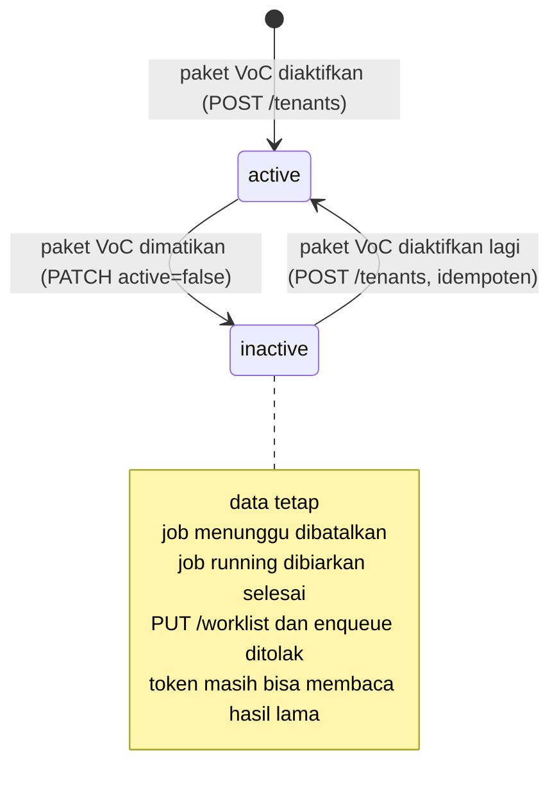

# Multi-Tenant Readiness — Design

> [!abstract] Navigasi
> [[README|Index]] · [[01-PLAN|Plan]] · [[02-DESIGN|Design]] · [[03-IMPLEMENTATION|Implementation]] · [[04-OPEN-QUESTIONS|Open Questions]]

> [!important] Model yang dipakai (per 2026-10-21)
> - **OneBox = source of truth & control panel.** Tenant (= site, satu site = satu company) hidup dan mati karena **paket VoC** diaktifkan/dimatikan di OneBox.
> - **Semua panggilan satu arah: OneBox → crawler.** Crawler tidak memegang kredensial OneBox dan tidak pernah memanggil OneBox (**opsi D**).
> - OneBox mendaftarkan tenant (provisioning), mendapat token tenant, lalu **mengirim (push) snapshot worklist** memakai token itu.
> - Crawler **tanpa setup manual** dan membagi worker antar tenant dengan **weighted round robin**; satu akun Apify milik platform (anonim bagi tenant), biaya dicatat per tenant.
>
> Sumber: jawaban Sayyid di [[04-OPEN-QUESTIONS]] (Q-01 – Q-05, Q-08, Q-09, Q-12, Q-18), keputusan opsi D di [[04-OPEN-QUESTIONS#Q-03]].

> [!warning] Sisi OneBox belum diverifikasi ke kode
> Disusun dari kode crawler + dokumen markdown. Kode OneBox belum dibaca (repo sedang disiapkan di laptop cadangan) dan sebagian hal sudah diimplementasi di sana ([[04-OPEN-QUESTIONS#Q-31]]). Klaim sisi OneBox = `[asumsi]` sampai inventaris selesai. Opsi D juga bergantung pada keandalan queue OneBox ([[04-OPEN-QUESTIONS#Q-32]]).

---

## 1. Prinsip desain

| # | Prinsip | Asal |
|---|---|---|
| P1 | **Satu deployment & satu database** crawler untuk semua tenant; isolasi per baris lewat `company_id` | MEETING_NOTES §3.1, BRAINSTORM §3.3 |
| P2 | **OneBox = source of truth & control panel** — "siapa, apa, kapan" datang dari OneBox | ADR-0001, ADR-0003, Q-01 |
| P3 | **Satu site = satu company** | Q-18 |
| P4 | **Tidak ada setup manual di crawler** — tenant, token, worklist, setting dipicu dari OneBox | Q-01, Q-05, Q-08 |
| P5 | **Semua kredensial dikelola OneBox**; crawler hanya menyimpan hash token dan **tidak memegang kredensial OneBox** | Q-04, Q-03 (opsi D) |
| P6 | **Panggilan satu arah OneBox → crawler** | Q-03 (opsi D) |
| P7 | **Setiap query ter-scope `company_id`**; tenant diturunkan dari token, tidak pernah dari parameter request | SPEC §6 |
| P8 | **Kegagalan satu tenant tidak menular** | SPEC §4.3 |
| P9 | **Tenant nonaktif → data tetap**; job yang belum jalan (`queued` / `retry_wait` / `awaiting_source`) dibatalkan, job `running` selesai | Q-09 |
| P10 | **Weighted round robin** antar tenant di crawler | Q-12 |
| P11 | **Satu akun Apify milik platform**; tenant anonim terhadap engine (tanpa akun/rotasi/top-up per tenant). Biaya tetap **teratribusi per tenant** | Q-11 |

---

## 2. Kondisi sekarang (as-is)

Kode crawler `dev` @ `7021cd0`.

### 2.1 Yang sudah multi-tenant `[code]`

| Komponen | Bukti |
|---|---|
| Tabel ber-`company_id` + index | `app/db/models.py`: `api_clients` (L68), `worklist_sync_states` (L100, unik per company), `crawl_batches` (L122), `crawl_jobs` (L169), `locations` (L276, unik `company_id+source+external_place_id`), `reviews` (L402, unik `company_id+review_hash`), `fetch_logs` (L485), `competitors` (L519), `crawl_window_log` (L597) |
| Token terikat satu company | `ApiClient` (`models.py:68`), hanya `secret_hash` disimpan; scope yang dipakai router: `reviews:read`, `crawl:read`, `analysis:write` |
| Fungsi token lengkap | `app/services/api_client_service.py`: issue / revoke / rotate (dengan masa tumpang tindih) / grant scope |
| Tenant diturunkan dari token | `apps/api/app_api/service_auth.py:28` `require_service_principal` |
| Antrean & worker membawa `company_id` | `crawl_queue.py`, `crawl_worker.py:66` |
| Validasi + upsert + soft-deactivate worklist | `WorklistSyncService._validate_payload` / `_apply` (`worklist_sync_service.py`) — **dipakai ulang oleh opsi D** |
| Test isolasi | `tests/test_tenant_isolation.py`, `tests/test_worklist_sync.py` |

### 2.2 Yang masih satu tenant / manual / arah pull `[code]`

| Komponen | Lokasi | Nasib di opsi D |
|---|---|---|
| Config tenant tunggal | `app/config.py:189-190` `onebox_site_id`, `onebox_company_id` | Dihapus setelah transisi |
| Kredensial OneBox di crawler | `ONEBOX_SVC_EMAIL/PASSWORD` + login `onebox_worklist_client.py:105-137` | **Dihapus** (crawler tidak memanggil OneBox) |
| Pull worklist | `OneBoxWorklistClient.get_worklist`, `WorklistSyncService.refresh` | Diganti endpoint terima snapshot |
| Refresh on-demand | `crawl_queue.py:224/613`, `integration_analysis.py:~107`, `fetch_service.py:44` | **Dihapus** (sumber bahaya §2.4) |
| Setup manual lewat CLI | `scripts/manage_company.py`, `manage_api_client.py`, `refresh_worklist.py` | Hanya alat darurat ops |
| `companies` tanpa penghubung & status | `models.py:31-49` | Ditambah kolom (§3.7) |
| Antrean worker FIFO global | `crawl_worker.py:120` | Weighted round robin (§3.5) |
| Pool multi-akun Apify dengan rotasi saat exhausted, tanpa atribusi | `apify_token_pool.py:16`, `config.py:164` | Cukup satu token di `APIFY_API_TOKENS` (tanpa perubahan kode); tambah atribusi per tenant (§3.6) |

### 2.2b Kondisi OneBox (MT-03 putaran 1)

Semua `[code]`, dibaca dari repo OneBox (WSL `onebox`, branch `feature/DNGO19-3549_VOC-AI-Ticket-Entitlement`). Detail dan sisa pekerjaan: [[04-OPEN-QUESTIONS#Q-31]], [[04-OPEN-QUESTIONS#Q-32]].

| Hal | Temuan | Dampak ke desain |
|---|---|---|
| Builder worklist | `VocWorklist::forSite($siteId)` (registry `VocTarget`, fallback Connection); bentuk item sudah sama dengan yang di-parse crawler | Snapshot opsi D = bungkus builder ini + versi (MT-32) |
| Tenant di endpoint OneBox | `VocWorklistController` mengambil site dari JWT `sid` | Selaras prinsip P7 |
| Client ke crawler | `VoiceOfCustomerSystemClient`: mode `service` (`Options.service_token`) dan `user`; `clientForSite()` per site; retry hanya 2x dalam request (2s/8s) | Perlu **outbox** untuk push/provisioning (MT-33); token level site (Q-36) |
| Queue/outbox keluar | Tidak ada untuk VoC. Ada `VocSchedule`/`VocScheduleRun` (durable, cron) dan infrastruktur RabbitMQ umum | Usulan outbox tabel DB (Q-32) |
| "Paket VoC" | Enam benefit terpisah (`VOC_AI`, `VOC_REVIEW`, `VOC_SCRAPE`, `VOC_SCHED`, `VOC_COMP`, `VOC_TICKET`); belum ada pembayaran | Definisi gerbang tenant harus diputuskan (Q-35) |
| Provisioning lama | `provisionLocation`/`provisionCompetitor`/`locationResyncAction`, `provisioning_status` di item worklist | Diganti oleh push snapshot (MT-30/33) |

### 2.3 Flag entitlement sisa di crawler `[code]`

`companies.ai_enable_flag`, `total_enable_review`, `analyze_competitor_flag` diisi lewat CLI `manage_company.py`. Menurut Q-08 nilainya mengikuti OneBox → dikirim di payload provisioning ([[#3.3 Provisioning token per tenant]]).

### 2.4 Bahaya laten yang sudah ada hari ini

> [!warning] Refresh worklist on-demand bisa menyalin worklist satu site ke company lain
> `[code]` · **Diamankan sementara oleh MT-02 (2026-10-21)**: company yang bukan pemilik site ditolak oleh `WorklistSyncService.refresh()`. Hilang total di opsi D (jalurnya dihapus, MT-22)

Tiga jalur memanggil refresh worklist dengan `company_id` milik pemanggil, tetapi login ke OneBox memakai `site_id` global:

| Jalur | Lokasi |
|---|---|
| Enqueue crawl dengan target tak dikenal | `app/services/crawl_queue.py:224` → `_refresh_worklist_once` (L613-650) |
| Analisa untuk lokasi tak dikenal | `apps/api/app_api/routers/integration_analysis.py:~107` |
| Fetch service | `app/services/fetch_service.py:44-50` |

Bila site 177 punya company & token sendiri lalu memanggil `POST /crawl-jobs` untuk target yang belum dikenal, crawler login sebagai site 169 dan meng-upsert cabang Hermina ke company site 177, sekaligus menonaktifkan cabang site 177. Di opsi D crawler tidak pernah login ke OneBox, jadi jalur ini dihapus ([[#3.4 Worklist push (opsi D)]]).

### 2.5 Divergensi `dev` vs `staging` `[code]`

| Commit di dev | Isi | Revert di staging | Status |
|---|---|---|---|
| `2d47205` | Prompt AI lintas sektor | `b500219` | **Disengaja** — staging tetap prompt Hermina untuk testing, rilis bertahap (Q-14) |
| `13ad618` | Resolve lokasi OneBox di dalam tenant | `92fc7d3` | Diduga alasan sama (Q-15) |

---

## 3. Target (to-be)

### 3.1 Pembagian peran



Semua panah dimulai dari OneBox. Crawler hanya menjawab.

| Hal | OneBox | Crawler |
|---|---|---|
| Tenant ada / aktif | Pemilik (paket VoC) | Cermin, ditulis hanya lewat panggilan OneBox |
| Token tenant | Menyimpan token mentah di Connection; tampil ter-mask di Setup Parameter | Membuat token, menyimpan **hash** |
| Cabang & kompetitor | Pemilik; mengirim snapshot | Menerapkan snapshot terbaru |
| Kapan crawl | Pemilik (trigger `crawl-jobs`) | — |
| Retry panggilan antar sistem | **Pemilik (queue OneBox)** | Endpoint idempoten |
| Urutan eksekusi antar tenant | Memberi bobot | Weighted round robin |
| Setting AI/ML per tenant | Pemilik | Menerima & memakai |

### 3.2 Siklus hidup tenant digerakkan paket VoC

> [!note] Ini jawaban untuk "discovery"
> Crawler **tidak mencari** tenant. Tenant terdaftar karena **OneBox memanggil crawler saat paket VoC diaktifkan**. Baris `companies` di crawler hanyalah cermin site OneBox, dibuat oleh panggilan OneBox, bukan oleh operator.





| Kejadian di OneBox | Panggilan ke crawler | Efek di crawler |
|---|---|---|
| Paket VoC aktif (pertama kali) | `POST /tenants`, lalu `PUT /worklist` | Buat company cermin + token; terapkan snapshot |
| Paket VoC aktif lagi | `POST /tenants` (idempoten), lalu `PUT /worklist` | `is_active=true`; token lama tetap; lanjut dari cursor terakhir |
| Paket VoC dimatikan | `PATCH /tenants/{site_id}` `{active:false}` | `is_active=false`, `deactivated_at`; job `queued` / `retry_wait` / `awaiting_source` → `cancelled` (`last_error_code=tenant_inactive`); enqueue & push → `409 TENANT_INACTIVE` |
| Bobot / setting diubah | `PATCH /tenants/{site_id}` | Simpan `weight` / setting (kolomnya ditambah di MT-40 / MT-44) |
| Tombol Regenerate | `POST /tenants/{site_id}/token:rotate` | Token baru; token lama berlaku sampai masa tumpang tindih habis |
| Cabang/kompetitor berubah, tombol Refresh, scheduled push | `PUT /worklist` | Terapkan snapshot bila versinya lebih baru |

Karena tidak ada self-healing dari crawler, **deaktivasi bergantung pada retry queue OneBox** (Q-29, Q-32). Sebagai pengaman, scheduled push OneBox juga menyertakan status paket: OneBox membandingkan `GET /tenants/{site_id}` dengan status paket di sisinya dan mengirim ulang `PATCH` bila berbeda.

### 3.3 Provisioning token per tenant

`ApiClientService.issue/rotate/revoke` sudah ada di crawler; yang ditambahkan hanya endpoint yang dipanggil OneBox, sehingga CLI `manage_api_client.py` tidak dibutuhkan.

**Kunci provisioning.** Endpoint `/tenants` tidak bisa memakai token tenant (tenantnya belum ada). Dibutuhkan **satu kunci platform** OneBox → crawler (bukan `ApiClient`; tidak terikat company):
- Kunci mentah disimpan di config OneBox (P5); crawler menyimpan **hash**-nya di env (`ONEBOX_PROVISIONING_KEY_HASH`) — satu-satunya secret terkait OneBox di crawler, dan itu pun hanya hash.
- Kunci ini **tidak** bisa membaca review atau mengirim worklist tenant mana pun.

**Kontrak (usulan):**

```http
POST /api/integration/v1/tenants
Authorization: Bearer <kunci provisioning>

{
  "site_id": 177,
  "site_name": "Site Testing",
  "weight": 1,
  "settings": {"ai_enabled": true, "analyze_competitor": false, "prompt_profile": "generic"}
}

201 Created (baru) / 200 OK (sudah ada)
{
  "data": {
    "company_id": 12, "site_id": 177, "site_name": "Site Testing",
    "is_active": true, "deactivated_at": null, "created": true,
    "worklist": {"snapshot_version": null, "applied_at": null, "items": 0, "last_error": null},
    "credential": {"key_id": "…", "last_used_at": null, "expires_at": null},
    "token": {"key_id": "…", "value": "voc_<env>_<key_id>.<secret>", "scopes": ["…"]}   ← hanya saat token baru terbit (POST pertama / rotate); selain itu null
  },
  "meta": {"api_version": "v1", "request_id": "…"}
}
```

```http
GET /api/integration/v1/tenants/177
Authorization: Bearer <kunci provisioning>

200 {"data": {"site_id": 177, "company_id": 12, "is_active": true, ...,
              "worklist": {"snapshot_version": 42, "applied_at": "...", "items": 12, "last_error": null},
              "credential": {"key_id": "…", "last_used_at": "...", "expires_at": null}},
     "meta": {...}}          ← tidak pernah memuat token mentah
```

Scope token tenant: `reviews:read`, `crawl:read`, `crawl:enqueue`, `analysis:write`, `worklist:write` (nama sesuai scope yang sudah dipakai router; `worklist:write` baru).

Error: `401 INVALID_PROVISIONING_KEY` · `503 PROVISIONING_NOT_CONFIGURED` · `409 TENANT_MODE_NOT_MANAGED` · `404 TENANT_NOT_FOUND` · `400 INVALID_PARAMETER`.

**Di Setup Parameter OneBox** (usulan, Q-28): token mentah tampil sekali, setelah itu ter-mask + status; tombol Regenerate (rotasi dengan masa tumpang tindih) dan Refresh; status sinkron `menunggu crawler` / `tersinkron (versi N)` / `gagal — mencoba lagi` (Q-29).

### 3.4 Worklist push (opsi D)

**Ide:** OneBox menyusun **snapshot lengkap** worklist satu site (bentuk sama dengan `data[]` `VocWorklist` sekarang) dan mengirimnya ke crawler. Crawler mengganti worklist tenant itu dengan isi snapshot.

**Kontrak:**

```http
PUT /api/integration/v1/worklist
Authorization: Bearer <token tenant site 177>

{
  "snapshot_version": 42,
  "generated_at": "2026-10-21T08:15:00Z",
  "items": [
    {"kind": "location", "onebox_target_id": 901, "onebox_location_id": 1705,
     "external_place_id": "ChIJ...", "branch_name": "Cabang A", "city": "Depok", "ai": {...}},
    {"kind": "competitor", "onebox_target_id": 955,
     "external_place_id": "ChIJ...", "branch_name": "Kompetitor X"}
  ]
}
```

| Respons | Kapan |
|---|---|
| `200 {"data":{"status":"applied","snapshot_version":42,"company_id":12,"site_id":177,"fetched":2,"upserted":2,"deactivated":0,"applied_at":"…"},"meta":{…}}` | Snapshot diterapkan |
| `200 {"data":{"status":"stale","snapshot_version":43,…},"meta":{…}}` | Versi ≤ yang tersimpan — tidak diproses; `snapshot_version` = versi yang berlaku. **Sukses bagi OneBox** |
| `400 {"error":{"code":"INVALID_SNAPSHOT","message":"Worklist item 1 is missing external_place_id."}}` (kontrak `/api/integration/` memakai 400, bukan 422) | Snapshot invalid — **seluruhnya** ditolak, worklist lama tetap. Satu pesan (fail-fast); daftar error per item bisa menyusul bila dibutuhkan |
| `409` kode `TENANT_INACTIVE` / `TENANT_MODE_NOT_MANAGED` / `TENANT_NOT_LINKED` | Tenant nonaktif / crawler bukan mode managed / company tidak terhubung ke site |
| `400 INVALID_PARAMETER` | Body salah bentuk, versi bukan integer positif, lebih dari 5.000 item |
| `401 INVALID_SERVICE_TOKEN` / `403 INSUFFICIENT_SCOPE` | Token invalid / tanpa scope `worklist:write` |

**Aturan pemrosesan di crawler** (terimplementasi di `WorklistSyncService.apply_snapshot`, MT-13):
1. **Tenant dari token**, tidak ada `site_id` di body — site 177 tidak bisa mengirim worklist atas nama site 169.
2. **Full snapshot:** item di snapshot di-upsert; target tenant itu yang **tidak ada** di snapshot di-soft-deactivate (data tetap, berhenti di-crawl). Sama dengan `_apply` sekarang.
3. **Versi monoton** (integer ≥ 1; `stale` = sukses bagi OneBox, termasuk saat kiriman diulang): `snapshot_version` per tenant disimpan; versi ≤ tersimpan → `stale`. Asal versi → Q-33 (usulan: counter per site di OneBox).
4. **Atomik per tenant:** satu transaksi dengan row lock pada state tenant; dua kiriman bersamaan diserialkan, versi tertinggi menang.
5. **Validasi sama dengan sekarang** (`_validate_payload`: `kind`, `external_place_id` wajib, tanpa duplikat, `onebox_target_id` unik).

**Builder sudah ada:** `VocWorklist::forSite($siteId)` di OneBox ([[#2.2b Kondisi OneBox (MT-03 putaran 1)]]); snapshot hanya menambah `snapshot_version` dan `generated_at`.

**Pemicu di OneBox** (Q-16): paket aktif · cabang/kompetitor berubah (dengan **debounce** per site) · tombol Refresh · **scheduled push** (usulan tiap 60 menit atau sebelum tiap window crawl). Semua lewat queue; jalur simpan admin tidak menunggu crawler.

**Deteksi ketinggalan:** OneBox membaca `GET /tenants/{site_id}` → `worklist.snapshot_version`. Bila lebih kecil dari versi terbaru di OneBox, kirim ulang.

**Kegagalan:**

| Kejadian | Akibat | Penanganan |
|---|---|---|
| Crawler mati saat push | Kiriman gagal | Queue OneBox retry + backoff; status di Setup Parameter |
| OneBox mati | Tidak ada kiriman baru | Crawler tetap crawl dengan snapshot terakhir |
| Kiriman lama datang terlambat | Bisa menimpa yang baru | Ditolak sebagai `stale` |
| Snapshot invalid | `422` | Worklist lama tetap; error tampil di Setup Parameter |
| Kiriman hilang tanpa ketahuan | Crawler ketinggalan | Scheduled push + cek versi |

**Amandemen ADR-0003.** ADR-0003 D1 memilih *pull worklist* untuk menghindari **push sinkron per entitas di jalur simpan** (lambat, dual-write). Opsi D tidak mengulangi masalah itu: kirimannya **async** (queue), **snapshot penuh** (semantik rekonsiliasi sama dengan pull), dan **berversi + idempoten**. Yang berubah hanya siapa yang memulai panggilan. Dicatat di ADR-0006 (MT-01).

**Biaya yang diterima:** OneBox memikul retry, debounce, dan status (Q-32); self-healing dari crawler hilang; client pull + commit "registry mode" sebagian jadi usang. Bila queue OneBox ternyata rapuh → fallback **opsi C** (crawler pull dengan kredensial mesin, otorisasi berdasarkan paket).

### 3.5 Weighted round robin antar tenant

Dikerjakan di `CrawlWorker.claim_next` (`crawl_worker.py:105-130`). Keadaan disimpan di DB (aman untuk banyak worker).

```
claim_next(worker_id):
    kandidat = tenant aktif yang punya job due
               dan job berjalannya < max_concurrency_per_tenant
    skor(tenant) = job yang di-claim tenant itu dalam jendela terakhir (mis. 60 menit) / weight
    urutkan kandidat: skor terkecil dulu, seri → job due tertua
    untuk tenant dalam urutan itu:
        job = job due tertua tenant itu  FOR UPDATE SKIP LOCKED
        dapat → claim & kembalikan
    tidak ada → None
```

Contoh: bobot site 169 = 3, site 177 = 1 → ± 3 job site 169 untuk tiap 1 job site 177. Tenant tanpa job tidak menahan kapasitas. Butuh index `crawl_jobs (company_id, status, available_at)`. Bobot, default, batas konkurensi, dan prioritas `regular_delta` vs `initial_backfill` → Q-26.

### 3.6 Apify: satu akun platform, biaya per tenant

**Keputusan (Q-11):** Apify dipakai lewat **satu akun milik platform**. Dari sisi tenant engine-nya anonim: tidak ada akun, kredit, atau konfigurasi Apify di sisi tenant, dan tidak ada rotasi akun.

| Aspek | Desain |
|---|---|
| Kredensial | `APIFY_API_TOKENS` berisi satu token (env crawler, tidak pernah keluar dari crawler). Pool tetap dipakai dengan satu entri |
| Tenant | Tidak melihat Apify di mana pun: bukan di provisioning, Setup Parameter, worklist, maupun respons API |
| Atribusi | Setiap run dicatat dengan `company_id`, review yang ditagih, dan perkiraan biaya (kolom di `fetch_logs`/`crawl_jobs` atau tabel `source_usage`) — MT-41 |
| Laporan | Biaya pokok per tenant per bulan vs harga VoC (± Rp200.000/lokasi); $20 ≈ ± 100.000 review — keduanya perkiraan Sayyid |
| Kegagalan akun | Akun habis/ditolak tetap menghasilkan error jelas per job (logika *exhausted* tidak dihapus); semua tenant terdampak bersama, jadi harus ada alert (Q-22, Q-34) |
| Batas bersama | Concurrent runs dan plafon akun berlaku lintas tenant → `CRAWL_MAX_CONCURRENCY_PER_TENANT` dan total worker ≤ batas akun (Q-34) |

Beban (Q-13): tenant terbesar ± 100 lokasi × ± 1.000 review = ± 100.000 review backfill; rata-rata ± 500 review/lokasi.

### 3.7 Model data (crawler)

**Sudah ada (MT-10, `20261022_0012`)**

| Perubahan | Detail |
|---|---|
| `companies.onebox_site_id` | `integer`, **unik** (unique index `uq_companies_onebox_site`), nullable (company non-OneBox) — Q-18 |
| `companies.is_active` / `deactivated_at` | `boolean not null default true` / `timestamptz null` |
| `worklist_sync_states.snapshot_version` / `applied_at` | `bigint null` / `timestamptz null` — versi snapshot terakhir yang diterapkan (tabel sudah satu baris per company) |
| Backfill | `onebox_site_id` dari `worklist_sync_states.site_id`, hanya bila tidak ambigu dan belum dipakai company lain; sisanya dibiarkan kosong dan dicatat |

**Menyusul (sengaja belum, bentuknya belum pasti)**

| Perubahan | Di task | Menunggu |
|---|---|---|
| `companies.weight` (`integer not null default 1`, `> 0`) + index `crawl_jobs (company_id, status, available_at)` | MT-40 | Q-26 |
| Kolom setting tenant/lokasi (AI, prompt profile, nanti kategori ML); flag lama `ai_enable_flag`, `analyze_competitor_flag`, `total_enable_review` diisi darinya | MT-44 | Q-30 dan rencana taksonomi per lokasi |
| Atribusi Apify per `company_id` | MT-41 | — |
| Status job `cancelled` | MT-23 | tanpa migration (`status` tanpa constraint); butuh kode di `crawl_queue`/`crawl_batch_view` |

### 3.8 Konfigurasi crawler

| Env | Sekarang | Target |
|---|---|---|
| `ONEBOX_BASE_URL`, `ONEBOX_SVC_EMAIL`, `ONEBOX_SVC_PASSWORD`, `ONEBOX_SITE_ID`, `ONEBOX_COMPANY_ID`, `ONEBOX_WORKLIST_PATH` | Wajib untuk pull | **Dihapus** setelah transisi (hanya dipakai mode `single`) |
| `ONEBOX_TENANT_MODE` | — | **Ada (MT-11).** `single` (default; pull lama, satu tenant) / `managed` (push + provisioning). `managed` menolak `ONEBOX_SITE_ID`/`ONEBOX_COMPANY_ID` saat boot dan hanya memperingatkan sisa `ONEBOX_BASE_URL`/`SVC_*` |
| `ONEBOX_PROVISIONING_KEY_HASH` | — | Baru — hash kunci provisioning |

Akhir transisi: crawler **tidak punya satu pun kredensial OneBox**.

### 3.9 Keamanan

| Ancaman | Mitigasi |
|---|---|
| Token tenant A dipakai untuk tenant B | Principal terikat satu company `[code]`; worklist tenant diturunkan dari token |
| Kunci provisioning bocor | Tidak bisa membaca data atau mengirim worklist; hanya registry tenant. Rotasi via config, panggilan dicatat |
| Kredensial OneBox bocor dari crawler | Tidak ada — crawler tidak menyimpannya (opsi D) |
| Token tampil di layar | Tampil sekali, setelahnya ter-mask (Q-28) |
| Refresh lintas tenant (§2.4) | Jalur dihapus; interim MT-02 |
| Kredensial tercetak di log | Token/secret tidak pernah dicetak; diuji di provisioning & push |

---

## 4. Aturan yang tidak boleh dilanggar

1. Setiap query di crawler ter-scope `company_id`; pengecualian hanya pemilihan tenant di `claim_next`, dan diberi komentar.
2. Tenant diturunkan dari token, tidak pernah dari parameter request atau body.
3. Crawler tidak membuat tenant atas inisiatif sendiri; registry hanya ditulis lewat panggilan OneBox.
4. **Crawler tidak memanggil OneBox** dan tidak menyimpan kredensial OneBox.
5. Snapshot worklist diterapkan utuh atau tidak sama sekali; versi lama tidak boleh menimpa versi baru.
6. Kegagalan satu tenant tidak menghentikan tenant lain.
7. Data tenant tidak dihapus saat tenant nonaktif.
8. Token mentah hanya ada di OneBox; crawler menyimpan hash.
9. Crawler tidak menerima jadwal; jam crawl ditentukan OneBox.

## 5. Keputusan yang ditolak / digantikan

| Opsi | Alasan | Sumber |
|---|---|---|
| Satu deployment per tenant | Biaya linear | BRAINSTORM §4, MEETING_NOTES §3.1 |
| Database per tenant | Isolasi sudah di skema | BRAINSTORM §3.3 |
| Service yang loop semua site | Akan lambat | Q-01 |
| Crawler menarik daftar tenant (`GET /api/VocTenants`, spec Opsi C) | Diganti provisioning dari OneBox | Q-01 |
| Login OneBox tanpa `siteId` | Satu site = satu company | Q-02 |
| Crawler login dengan akun user per site (opsi A) | Password banyak tenant di crawler; akun manusia dipakai mesin | Q-03 |
| Satu akun layanan global anggota semua site (opsi B) | Kredensial OneBox di crawler + keanggotaan per site; hanya mode transisi | Q-03, Q-27 |
| Kredensial mesin + pull berbasis paket (opsi C) | **Cadangan**, bukan ditolak — dipakai bila queue OneBox rapuh | Q-03, Q-32 |
| Pull worklist (ADR-0003 D1) | Diamandemen jadi push snapshot async berversi | Q-03, §3.4 |
| `crawl_windows` di data tenant | Diganti bobot round robin | Q-06 |
| Setup tenant lewat CLI | Melanggar P4; CLI hanya darurat ops | Q-01, Q-05 |
| Crawler punya scheduler window sendiri | Satu owner jadwal: OneBox | ADR-0003 |
