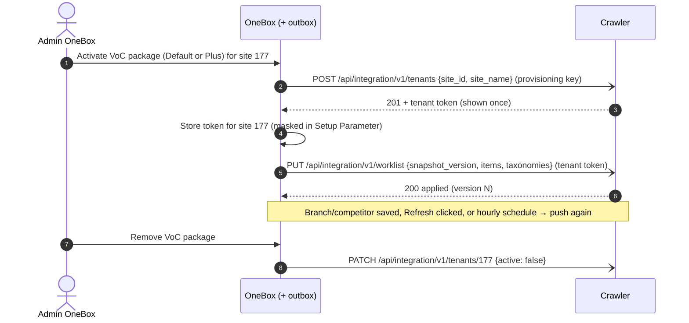

# Multi-Tenant Readiness — OneBox Handoff

> [!abstract] Navigasi
> [[README|Index]] · [[01-PLAN|Plan]] · [[02-DESIGN|Design]] · [[03-IMPLEMENTATION|Implementation]] · [[04-OPEN-QUESTIONS|Open Questions]] · [[05-ONEBOX-HANDOFF|OneBox Handoff]]

> [!important] Who this is for
> The developer (and their coding agent) who will build and test the **OneBox side** of multi-tenant VoC. The crawler side is built and tested; it needs OneBox to call it. Read this file first; it is meant to be enough on its own. Follow the links only for background.

---

## 1. The goal in one paragraph

One crawler deployment serves every OneBox site that has a VoC package. **OneBox is the control panel and the only caller:** when a site gets a VoC package, OneBox registers it with the crawler, receives a tenant token, stores it, and from then on **pushes** that site's full worklist (branches + competitors + taxonomies) to the crawler whenever it changes. The crawler holds no OneBox credentials and never calls OneBox. Nothing is set up by hand on the crawler (no CLI, no per-tenant env).



## 2. State of the crawler side (2026-10-26)

| Piece | Crawler status | Where |
|---|---|---|
| Tenant columns on `companies` (`onebox_site_id`, `is_active`) + `snapshot_version` | done, merged into `dev` | migration `20261022_0012` (+ merge `20261022_0013`) |
| `ONEBOX_TENANT_MODE=single\|managed` | done, merged into `dev` | `app/config.py` |
| Apply a pushed snapshot (atomic, versioned) | done, tested on SQLite | branch `feature/multitenant-readiness` |
| `POST/GET/PATCH /tenants`, `POST /tenants/{site_id}/token:rotate` | done, tested on SQLite | same branch |
| `PUT /worklist` | done, tested on SQLite | same branch (code not yet committed) |
| `taxonomies` in `PUT /worklist` | **pending** (needs merging `dev`'s taxonomy work into the branch) | crawler owner |
| Tenant inactive → cancel waiting jobs, refuse enqueue | **pending** (MT-23) | crawler owner |
| Monthly usage in `GET /tenants/{site_id}` (for quotas) | **proposed** (Q-38, MT-41) | crawler owner |

Until the branch is merged into `dev`, run the crawler from `feature/multitenant-readiness`.

---

## 3. Crawler API you will call

All paths are under the crawler base URL. All JSON responses use the envelope `{"data": ..., "meta": {"api_version": "v1", "request_id": "..."}}`; errors use `{"error": {"code": "...", "message": "...", "request_id": "..."}}`. Send `X-Request-ID` if you want it echoed. Validation errors are **400 `INVALID_PARAMETER`** (not 422) under `/api/integration/`.

### 3.1 Two credentials

| Credential | Who holds it | Used for | Format |
|---|---|---|---|
| **Provisioning key** (one per environment) | OneBox config only. The crawler stores its HMAC in `ONEBOX_PROVISIONING_KEY_HASH` | `/tenants` endpoints only. Cannot read or write any tenant's data | `vocprov_...` |
| **Tenant token** (one per site) | OneBox, per site. The crawler stores only a hash | Everything for that site: `PUT /worklist`, `crawl-jobs`, `reviews`, `analysis` | `voc_<env>_<key_id>.<secret>` |

Create the provisioning key once per environment on the crawler host: `python -m scripts.generate_provisioning_key`. It prints the key (give to OneBox config) and the hash (put in the crawler `.env`). The hash only matches the `SERVICE_TOKEN_PEPPER` of that environment.

Tenant token scopes: `reviews:read`, `crawl:read`, `crawl:enqueue`, `analysis:write`, `worklist:write`.

### 3.2 `POST /api/integration/v1/tenants` — register a site (idempotent)

```http
POST /api/integration/v1/tenants
Authorization: Bearer <provisioning key>
Content-Type: application/json

{"site_id": 177, "site_name": "Site Testing"}
```

- `201` when the site is new, `200` when it already exists. Calling it again is safe.
- A **token is issued only when the site has no active tenant token** (first registration). It appears once, in `data.token.value`. Later calls return `"token": null`. Lost it? Use rotate (3.5).
- An inactive site is reactivated (data intact). The company name is not changed by repeat calls.
- Extra fields (e.g. `weight`) are ignored for now.

```json
{
  "data": {
    "company_id": 12, "site_id": 177, "site_name": "Site Testing",
    "is_active": true, "deactivated_at": null, "created": true,
    "worklist": {"snapshot_version": null, "applied_at": null, "items": 0, "last_error": null},
    "credential": {"key_id": "AbC...", "last_used_at": null, "expires_at": null},
    "token": {"key_id": "AbC...", "value": "voc_dev_AbC....<secret>", "scopes": ["analysis:write", "crawl:enqueue", "crawl:read", "reviews:read", "worklist:write"]}
  },
  "meta": {"api_version": "v1", "request_id": "..."}
}
```

### 3.3 `GET /api/integration/v1/tenants/{site_id}` — read state

Returns the same `data` without `token`/`created`. Use `worklist.snapshot_version` to detect that the crawler is behind (resend), and `worklist.last_error` to show why the last push was rejected. Never contains a token.

### 3.4 `PATCH /api/integration/v1/tenants/{site_id}` — switch off/on, rename

```json
{"active": false}
{"active": true}
{"site_name": "New name"}
```

Deactivating only marks the tenant (data stays). After MT-23 the crawler also cancels its waiting jobs and refuses new crawls and pushes (`409 TENANT_INACTIVE`). The token keeps working for reads.

### 3.5 `POST /api/integration/v1/tenants/{site_id}/token:rotate` — regenerate

```json
{"overlap_hours": 24}
```

Returns a new token in `data.token.value`. The old tenant token keeps working for `overlap_hours` (0–168, default 24) and then stops; `0` revokes it immediately. Store the new one before the overlap ends.

### 3.6 `PUT /api/integration/v1/worklist` — push the full worklist

```http
PUT /api/integration/v1/worklist
Authorization: Bearer <tenant token of site 177>

{
  "snapshot_version": 42,
  "generated_at": "2026-10-26T08:15:00Z",
  "items": [ ...same objects as data[] from VocWorklist::forSite($siteId)... ],
  "taxonomies": { ...same object as the taxonomies field of the pull worklist... }
}
```

- **The site comes from the token.** Never put `site_id`/`company_id` in the body; they are ignored.
- **Full snapshot:** every branch/competitor of the site, every time. Targets missing from the snapshot are switched off (soft; data kept). An empty `items` switches all of them off.
- **`snapshot_version`** must be a positive integer that increases on every change (Q-33: a counter per site in OneBox). A version that is **not higher** than the applied one returns `200` with `"status": "stale"` and changes nothing. **Treat `stale` as success.**
- **All or nothing:** an invalid snapshot is rejected whole (`400 INVALID_SNAPSHOT`, message says which item and field) and the previous worklist stays. The version is not consumed, so resend the fixed snapshot with the same version.
- At most 5,000 items.
- `taxonomies`: **pending on the crawler** (section 2). Shape is exactly the pull worklist's top-level `taxonomies` (key → body, e.g. `"kesehatan:0e20266e": {...}`), with `taxonomy_key` on each item. An invalid taxonomy body is skipped, not fatal.

```json
{"data": {"status": "applied", "snapshot_version": 42, "company_id": 12, "site_id": 177,
          "fetched": 12, "upserted": 12, "deactivated": 0, "applied_at": "..."},
 "meta": {"api_version": "v1", "request_id": "..."}}
```

### 3.7 Error codes

| Status | Code | Meaning / what OneBox does |
|---|---|---|
| 400 | `INVALID_PARAMETER` | Malformed request. Fix the caller; do not retry as is |
| 400 | `INVALID_SNAPSHOT` | Snapshot content invalid; show `message` in Setup Parameter; do not retry until fixed |
| 401 | `INVALID_PROVISIONING_KEY` / `INVALID_SERVICE_TOKEN` | Wrong credential; alert, do not retry |
| 403 | `INSUFFICIENT_SCOPE` | Token lacks the scope; re-register or rotate |
| 404 | `TENANT_NOT_FOUND` | Site never registered; call `POST /tenants` first |
| 409 | `TENANT_MODE_NOT_MANAGED` | Crawler is still in `single` mode; config issue on the crawler |
| 409 | `TENANT_INACTIVE` | Tenant switched off; do not retry |
| 409 | `TENANT_NOT_LINKED` | Token belongs to a company with no OneBox site; re-register |
| 503 | `PROVISIONING_NOT_CONFIGURED` | Crawler has no provisioning key hash yet |
| 5xx / network | — | Retry with backoff through the outbox |

---

## 4. What to build in OneBox

Task IDs match [[03-IMPLEMENTATION]]. Each needs tests in the OneBox repo.

| ID | Build | Acceptance |
|---|---|---|
| **MT-30** | Package activation hook: when a site gets a VoC package (Default or Plus), enqueue `POST /tenants`, store the returned token for the site, then enqueue the first worklist push. When the package is removed, enqueue `PATCH {active:false}` | Activating a package registers the tenant without any manual step; removing it switches the tenant off |
| **MT-31** | Setup Parameter (VoC): status (`waiting for crawler` / `synced (version N)` / `failed — retrying` + last error), masked token, **Regenerate** (rotate), **Refresh** (push now) | Admin sees sync state and can recover without a developer |
| **MT-32** | Snapshot builder: wrap `VocWorklist::forSite($siteId)` (items) + the taxonomies, plus a `snapshot_version` counter per site that increments on every branch/competitor/taxonomy change | Same items as the pull worklist; version strictly increases |
| **MT-33** | **Outbox** for calls to the crawler: durable job rows, retry with exponential backoff, debounce per site (several saves → one push), one push in flight per site, status recorded for MT-31. Hooks: branch/competitor create/edit/disable, Refresh button | Crawler down for 10 minutes → pushes arrive afterwards without a human |
| **MT-35** | Scheduled push (hourly or before each crawl window) + drift check: read `GET /tenants/{site_id}`; if `worklist.snapshot_version` is behind, push again; if `is_active` differs from the package state, PATCH again | Lost pushes and lost deactivations heal on their own |
| **Quota** | Enforce per-tenant monthly quotas (Q-35/Q-38): refuse to trigger AI analysis once the Jev budget is spent; refuse to enqueue crawls once the Apify quota is reached | Default and Plus limits are configuration, not constants |
| **Token use** | Use the tenant token for every crawler call of that site (`crawl-jobs`, `reviews`, `analysis`, `reply-suggestion`) | One token per site; no shared user/password |

### 4.1 Packages and quotas (Q-35)

| Package | Features | Monthly quota per tenant |
|---|---|---|
| Default | review, scrape, sched, comp (not built yet), ticket, AI analysis (Jev) | Jev $10 · Apify 100,000 |
| Plus | Default + AI summary (OpenAI) + auto reply (soon) | Jev $20 · Apify 500,000 · AI credit |

Values may change, so keep them in configuration. Units and enforcement details are still open: Q-37 (Apify unit, "AI credit"), Q-38 (who enforces), Q-40 (Jev price per token). The crawler already returns `tokens_used` / `token_usage` in every analysis response, so OneBox can meter Jev without crawler changes.

### 4.2 Where to start in the OneBox code

Found during a read-only inventory (MT-03, 2026-10-21). Paths under `onecloud/app/`:

| Path | Why it matters |
|---|---|
| `services/VocWorklist.php` — `forSite($siteId)`, `itemFromOptions()` | Already builds the items; reuse it for the snapshot |
| `controllers/api/v1/VocWorklistController.php` | Takes the site from the JWT `sid`; keep that rule |
| `services/VocCrawlQueue.php` — `enqueue()`, `clientForSite()` | Current single path to the crawler; `clientForSite()` picks the first eligible branch Connection |
| `library/VoiceOfCustomerSystemClient.php` | HTTP client; `service` mode reads `Options.service_token`; retries only twice inside the request (2s, 8s); has `whoami()` as a tenant guard |
| `controllers/VocController.php` — `VOC_BENEFITS`, `benefitPackages()` | The six VoC benefits and how packages add quota |
| `controllers/VocController.php` — `provisionLocation()`, `provisionCompetitor()`, `locationResyncAction()` | **Legacy** synchronous push to the crawler (ADR-0001). Replace it with the outbox; do not keep two paths. `locationResyncAction` is a good UI precedent for Refresh |
| `models/VocSchedule.php`, `models/VocScheduleRun.php`, `library/VocCron.php` | Durable, cron-driven pattern to copy for the outbox |
| `library/Rabbitmq.php`, `library/RabbitBroker.php` | RabbitMQ exists, but the recommendation is a DB outbox (Q-32) |

### 4.3 Decisions already made (do not reopen without a reason)

- OneBox is the control panel; the crawler never calls OneBox (option D, amends ADR-0003 D1).
- One site = one tenant = one crawler company.
- One platform-owned Apify account for all tenants; tenants never see Apify.
- Tenant inactive → waiting jobs cancelled, running jobs finish, data kept.
- Weighted round robin across tenants happens in the crawler.

### 4.4 Open questions owned by the OneBox side

Details in [[04-OPEN-QUESTIONS]]. Proposed answers exist for most; confirm or change them.

| ID | Question | Proposal |
|---|---|---|
| Q-31 | What else already exists in OneBox for multi-site? | Finish the inventory (pass 2) before building |
| Q-32 | Outbox: DB table or RabbitMQ? | DB outbox table + cron task |
| Q-33 | Where does `snapshot_version` come from? | Integer counter per site |
| Q-36 | Store the tenant token per site or copy it to every branch Connection? | Once per site (e.g. a `Setting` row); `clientForSite()` reads it first, falls back to `Connection.Options.service_token` during transition |
| Q-28 | Who can see/regenerate the token? | Shown once, masked afterwards; OneBox admins only |
| Q-29 | Crawler down during activation? | Admin action completes immediately; outbox retries; status visible |
| Q-37 / Q-38 / Q-40 | Quota units, enforcement, Jev price | See 4.1 |

### 4.5 Pitfalls

- **`verifyBenefit()` is not a check**: it increments `SiteBenefit.Quantity`. Use `hasBenefit` to gate (ADR-0001, technical consequences).
- **Never derive the tenant from request parameters**; always from the session/JWT site.
- **`stale` is success**: do not retry or alert on it.
- **Empty snapshot = switch everything off.** Make sure a failed query does not produce an empty push.
- **The token value is shown once.** Persist it in the same transaction as the outbox job result, or you will need to rotate.
- **Do not log tokens or the provisioning key.**

---

## 5. Run the crawler locally against your OneBox

From the crawler repo, branch `feature/multitenant-readiness`:

```bash
cp .env.example .env
```

Set at least (values are examples for local only):

```dotenv
APP_ENV=local
DATABASE_URL=postgresql://<user>:<password>@localhost:5432/<db>
ONEBOX_TENANT_MODE=managed
# leave ONEBOX_SITE_ID and ONEBOX_COMPANY_ID empty in managed mode (the app refuses to start otherwise)
REVIEW_SOURCE_MODE=mock
```

```bash
python -m scripts.generate_provisioning_key
```

Put the printed hash in `ONEBOX_PROVISIONING_KEY_HASH` and the key in the OneBox config. Then start the crawler (`docker compose up -d`, or `alembic upgrade head` followed by `uvicorn apps.api.main:app --port 8000`). `REVIEW_SOURCE_MODE=mock` avoids calling Apify.

Smoke test by hand:

```bash
curl -s -X POST "$CRAWLER/api/integration/v1/tenants" -H "Authorization: Bearer $PROVISIONING_KEY" -H "Content-Type: application/json" -d '{"site_id":177,"site_name":"Site Testing"}'
```

```bash
curl -s -X PUT "$CRAWLER/api/integration/v1/worklist" -H "Authorization: Bearer $TENANT_TOKEN" -H "Content-Type: application/json" -d '{"snapshot_version":1,"items":[{"kind":"location","external_place_id":"ChIJ-test","branch_name":"Cabang Test","onebox_location_id":1}]}'
```

```bash
curl -s "$CRAWLER/api/integration/v1/tenants/177" -H "Authorization: Bearer $PROVISIONING_KEY"
```

OneBox local setup: [[VOC_ONEBOX_SETUP_DEV]] and [[local-dev-setup-guide]].

---

## 6. Acceptance test (UAT, dev, sites 169 and 177)

1. Activate the VoC package for site 177 → Setup Parameter shows `synced (version 1)` and a masked token. **No CLI, no crawler env change.**
2. Add two branches to site 177 → the version increases and the crawler holds the new worklist (`GET /tenants/177`).
3. Stop the crawler, change a branch, start the crawler → the outbox delivers, the version catches up.
4. Trigger crawls for 169 and 177 → each company only gets its own data.
5. OneBox pulls reviews for 177 → Tickets appear in site 177 only.
6. Remove the package from 177 → tenant inactive, 169 unaffected. Add it back → resumes.
7. Spend the Jev budget of a test tenant → further AI analysis is refused by OneBox.

## 7. Contacts and changes

- Crawler owner: Sayyid. Crawler contract changes go through [[02-DESIGN]] §3.3–3.4 and this file.
- Record answers in [[04-OPEN-QUESTIONS]] following [[README#Protokol update (wajib diikuti)]].
